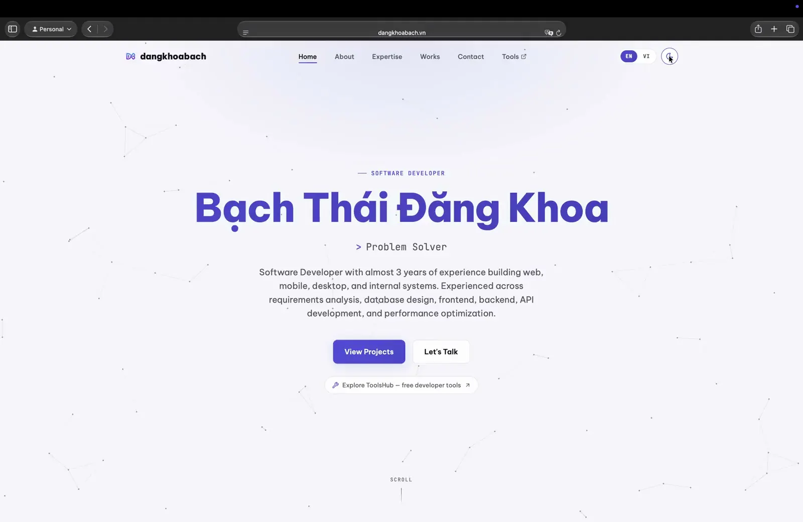
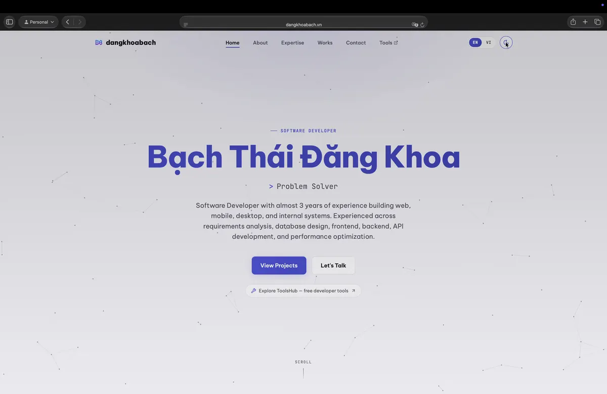
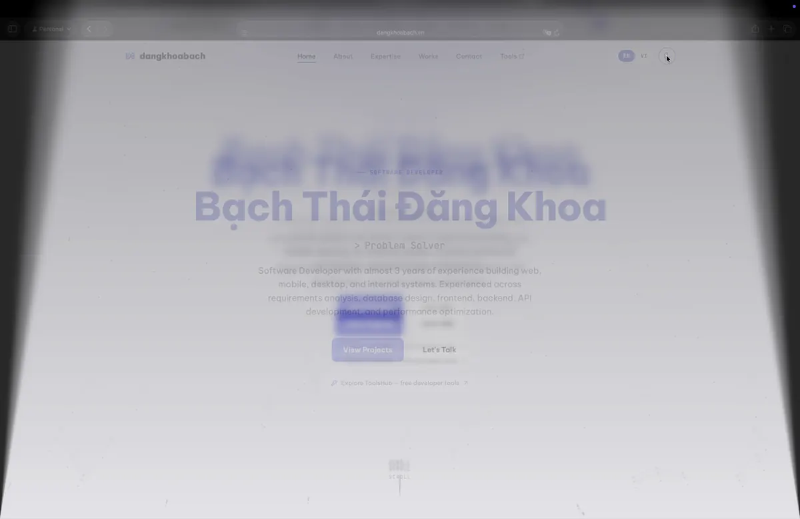
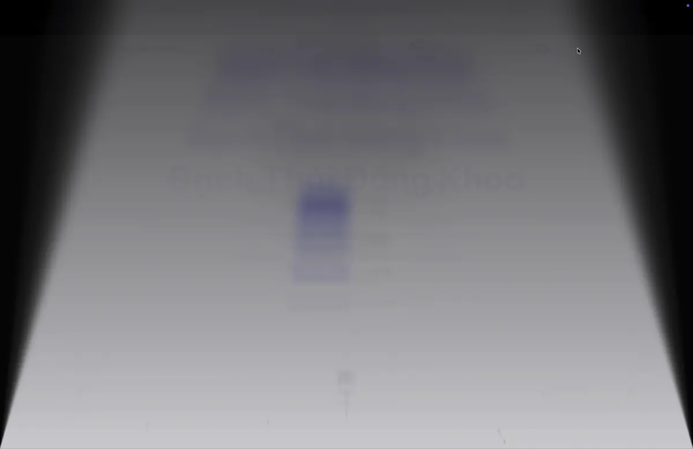
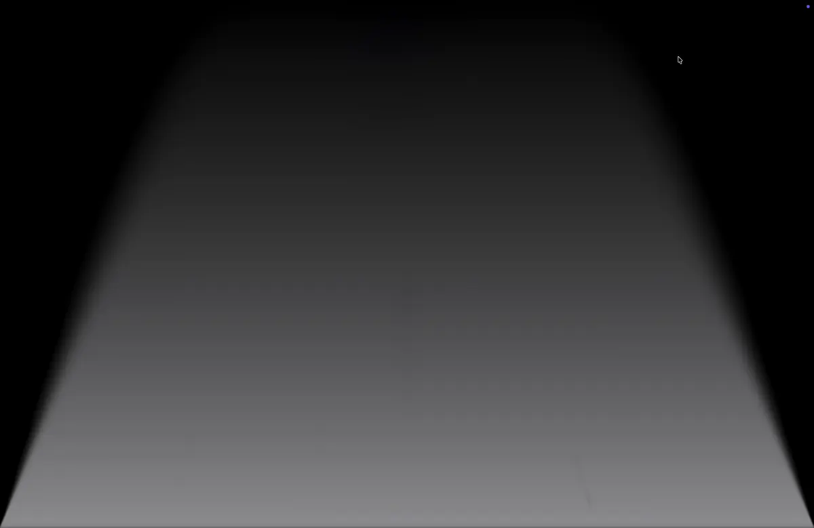
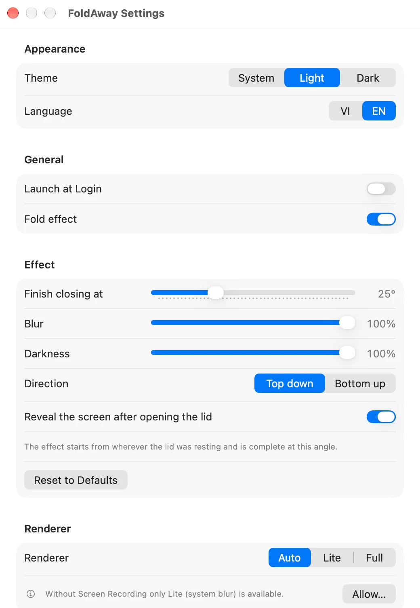
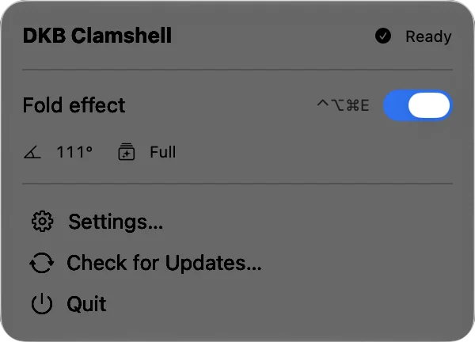

# FoldAway

A menu bar app that gives a MacBook's built-in display an iPhone Duo-style fold: as you lower
the lid, the picture stays anchored in space while the panel folds under it, blurs from the
hinge outward and fades to black. Every frame follows the lid angle sensor, not a timer. Stop
the lid anywhere and the screen comes back after a second, ready to use at that angle.



| Lid at rest | Blur begins, panel tilts | Folding under | Fade to black |
| :---: | :---: | :---: | :---: |
|  |  |  |  |

## What it does

- Follows the real hinge angle at 60 fps: a slow close, a normal close and a slam all look
  right.
- Blur and darkness are graded by distance from the hinge, and the effect is complete at the
  angle you choose (25° by default).
- When you open the lid and unlock, the picture un-blurs and brightens back in (a switch in
  Settings turns this off).
- Two renderers (below), picked automatically.
- Global shortcuts that work even while the screen is dark: **⌃⌥⌘E** turns the effect off,
  **⌃⌥⌘R** restores the default settings. Both can be re-recorded.
- A preview slider in Settings drives the whole pipeline by hand, so you can tune the effect
  without closing the lid.
- Menu bar only, no Dock icon. English and Vietnamese, light and dark appearance.

<table>
  <tr>
    <td width="50%"><picture><source media="(prefers-color-scheme: dark)" srcset="docs/screenshots/settings-dark.webp"></picture></td>
    <td width="50%"><picture><source media="(prefers-color-scheme: dark)" srcset="docs/screenshots/menubar-dark.webp"></picture></td>
  </tr>
</table>

### Two renderers

- **Full**: the Duo look. The screen is captured for about a second while the lid moves and
  redrawn with progressive blur, perspective toward the hinge and a fade to black. Needs the
  **Screen Recording** permission, which macOS re-confirms now and then. Nothing captured is
  stored or sent anywhere.
- **Lite**: works without any permission. A system blur layer fades in under a darkening
  gradient; it cannot tilt the content.

`Auto` (the default) uses Full when the permission is granted and Lite otherwise.

## Requirements

- macOS 14 or later.
- A MacBook with the lid angle sensor: MacBook Pro 16" (2019), MacBook Pro 14" and 16" (2021
  and later), MacBook Air (M2, 2022 and later). The 13" MacBook Pro, the M1 MacBook Air and
  desktops don't have it; the app says so and does nothing.

## Install

Download the latest version from
[apps.dangkhoabach.vn/dkb-clamshell](https://apps.dangkhoabach.vn/dkb-clamshell).

The app is signed with a self-signed certificate, not an Apple Developer ID, so macOS blocks
the first launch. Open it once from **System Settings → Privacy & Security → Open Anyway**.
Updates then arrive through **Check for Updates…** in the menu bar
([Sparkle](https://sparkle-project.org/), signed with EdDSA). The app checks
`updates.dangkhoabach.vn` once a day if you allow it and makes no other network calls.

FoldAway was called DKB Clamshell up to version 1.0.3. It is the same app with the same
bundle identifier, so an installed copy keeps its settings and keeps receiving updates.

## Known limits

- macOS doesn't let any app draw over the Lock Screen, so the opening effect plays once you
  have unlocked, not while the Lock Screen is up.
- Only the built-in display is affected.

## How it works

- **`FoldAwayCore`** (Swift package, no dependencies, tested headless):
  - `HIDLidAngleReader` reads the sensor as a HID feature report (Sensor page 0x20,
    Orientation usage 0x8A), in hundredths of a degree. The sensor refreshes every 100 ms.
  - `LidMotionTracker` turns those 10 Hz samples into a smooth 60 fps angle: it extrapolates
    from the last sample by its velocity, then low-passes the result. Interpolating between
    samples would be smooth but 100 ms late.
  - `FoldStateMachine` decides when the effect starts, follows and lets go: it starts from
    wherever the lid was resting, and a lid that stops part-way becomes the new resting angle.
  - `FoldProjection` and `EffectParameters` turn an angle into what the renderers draw: a
    planar homography with the hinge line fixed, plus graded blur and darkness.
- **`FoldAwayApp`** (SwiftUI and AppKit): a non-activating full-screen panel on the
  built-in display, a half-resolution ScreenCaptureKit stream that runs only while the lid is
  moving, Core Image filters drawn into a `CAMetalLayer` from a display link, Carbon global
  hot keys, Sparkle.

## Build from source

Requirements: Xcode 26 or later.

```zsh
./scripts/create-signing-cert.sh   # once: a self-signed identity, written to Local.xcconfig
open FoldAway.xcodeproj
```

`Local.xcconfig` (gitignored, only `CODE_SIGN_IDENTITY`) is the project's base configuration,
so the build fails until it exists. A stable identity matters: macOS keys the Screen Recording
permission on it, and an ad-hoc build would ask again after every rebuild. For a quick
unsigned build, `cp Local.xcconfig.example Local.xcconfig` is enough.

Tests:

```zsh
cd FoldAwayCore && swift test        # 41 tests; one reads the real sensor when there is one
xcodebuild test -project FoldAway.xcodeproj -scheme FoldAwayApp -destination 'platform=macOS'   # 7 tests
```

Releases are built, signed and published by hand: see [docs/release.md](docs/release.md).

## Forking

Change these before you ship your own build, so it neither replaces itself with the official
release nor shares its settings:

- `PRODUCT_BUNDLE_IDENTIFIER` in the Xcode project.
- `SUFeedURL` and `SUPublicEDKey` in `FoldAwayApp/Info.plist` (generate your own key with
  Sparkle's `generate_keys`).

## Contributing

Issues are welcome. This is a personal project, so pull requests are read but may not be
merged.

## Credits

The table of Mac models with a lid angle sensor started from
[samhenrigold/LidAngleSensor](https://github.com/samhenrigold/LidAngleSensor) (MIT).

## License

[MIT](LICENSE) for the source code. The FoldAway name, app icon and logo are not covered
by the license; use your own for a fork.
